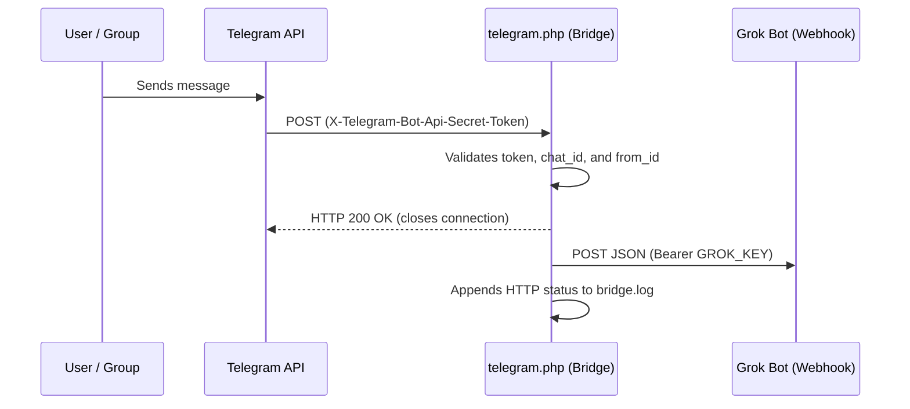

# Telegram → Grok Bot Webhook Bridge

Lightweight PHP webhook bridge between the **Telegram Bot API** and a **Grok Bot** webhook-triggered routine, waking the agent immediately whenever an authorized message arrives.

---

## How It Works



1. **Origin Authentication:** Verifies that the request uses `POST` and that the `X-Telegram-Bot-Api-Secret-Token` header matches `TG_SECRET` using constant-time comparison (`hash_equals`).
2. **Strict Allowlist Filtering:** Ignores messages sent by bots, updates without text/captions, and messages from users (`$ALLOWED_USERS`) or chats (`$ALLOWED_CHATS`) not explicitly allowlisted.
3. **Immediate Telegram ACK:** Responds with `200 OK` and flushes the connection (`fastcgi_finish_request` / `flush`) before calling Grok Bot, preventing webhook timeouts and duplicate retries.
4. **Forwarding & Privacy-Safe Logging:** Forwards the Telegram `update` payload to the Grok Bot webhook via cURL and writes only delivery metadata (`timestamp`, `update_id`, `chat_id`, and HTTP status code) to `bridge.log` — never logging message contents.

---

## Repository Structure

| File | Description |
| :--- | :--- |
| `telegram.php` | Main webhook bridge script that receives Telegram updates and forwards them to Grok Bot. |
| `config.example.php` | Configuration template (no sensitive data). Copy this file to `config.php`. |
| `config.php` | *(Git-ignored)* Holds your secret tokens and allowlisted chat/user IDs. |
| `.htaccess` | Apache rules disabling directory listing and blocking direct HTTP access to `config.php`, `bridge.log`, and internal files. |

---

## Prerequisites

- Web hosting with valid **HTTPS** (required by the Telegram Bot Webhook API).
- **PHP 7.4+** or **PHP 8.x** with the `curl` and `json` extensions enabled.
- Apache (for automatic `.htaccess` protection) or Nginx (see security note below).
- A Telegram bot created via [@BotFather](https://t.me/BotFather).
- A routine configured with a **Webhook** trigger in Grok Bot.

---

## Setup Guide

### 1. Get Your Grok Bot Webhook Credentials

Open your **Telegram (webhook)** routine in Grok Bot. Under the **Webhook** section, copy:
- **POST to** (Webhook URL) → used for `GROK_URL`
- **key** (Webhook Key) → used for `GROK_KEY`

If these fields are not directly visible in the UI, you can open them via deep links (or ask the bot for them):
- [Open Webhook URL](grokbot://app/v1/sidebar?target=webhook-url&automation=telegram-webhook-responder-mensagens) (`GROK_URL`)
- [Open Webhook Key](grokbot://app/v1/sidebar?target=webhook-key&automation=telegram-webhook-responder-mensagens) (`GROK_KEY`)

### 2. Generate Your Telegram Secret Token (`TG_SECRET`)

Generate a random secret token of **32 or more characters** containing only letters, digits, `_`, and `-`:

```bash
openssl rand -base64 48 | tr '+/' '_-' | tr -d '=' | cut -c1-40
```

### 3. Configure `config.php`

1. Copy `config.example.php` to `config.php`:
   ```bash
   cp config.example.php config.php
   ```
2. Fill in your credentials and allowlists in `config.php`:
   ```php
   define('TG_SECRET', 'YOUR_RANDOM_SECRET_TOKEN');
   define('GROK_URL', 'https://your-webhook-endpoint');
   define('GROK_KEY', 'YOUR_WEBHOOK_KEY');

   // Allowed numeric chat IDs (positive for private chats, negative for groups/supergroups)
   $ALLOWED_CHATS = [123456789, -1009876543210];

   // Allowed numeric user IDs
   $ALLOWED_USERS = [123456789];
   ```
3. Upload `telegram.php`, `config.php`, and `.htaccess` to your HTTPS server (e.g., `https://your-domain.com/bot/`).

### 4. Register the Webhook with Telegram

Open the following URL in your browser (or call it via `curl`), replacing:
- `BOT_TOKEN` with your bot token from `@BotFather`
- `https://your-domain.com/bot/telegram.php` with the public HTTPS URL where you uploaded `telegram.php`
- `YOUR_TG_SECRET` with the exact `TG_SECRET` defined in `config.php`

```text
https://api.telegram.org/botBOT_TOKEN/setWebhook?url=https://your-domain.com/bot/telegram.php&secret_token=YOUR_TG_SECRET
```

Telegram should respond with:
```json
{"ok":true,"result":true,"description":"Webhook was set"}
```

> **Note:** Once a Telegram webhook is active, periodic polling routines (`getUpdates`, such as 10-minute scheduled checks) will no longer receive updates and should be disabled.

---

## Diagnostics & Security

- **Delivery Log (`bridge.log`):** If a message does not wake the bot, check `bridge.log` in the same server directory. Each entry records the timestamp, `update_id`, `chat_id`, and the HTTP status returned by Grok Bot (`grok_http=200` or `202` indicates success):
  ```text
  2026-10-31T22:55:00-03:00 update=123456789 chat=123456789 grok_http=200
  ```
- **Privacy:** Neither message text nor secret tokens are ever written to `bridge.log`.
- **Nginx Users:** `.htaccess` only applies to Apache. If you run Nginx, add the following rule inside your `server` block to deny direct HTTP access to `config.php` and logs:
  ```nginx
  location ~ /(config(\.example|\.exemplo)?\.php|.*\.log|README\.md|\.git) {
      deny all;
      return 404;
  }
  ```
