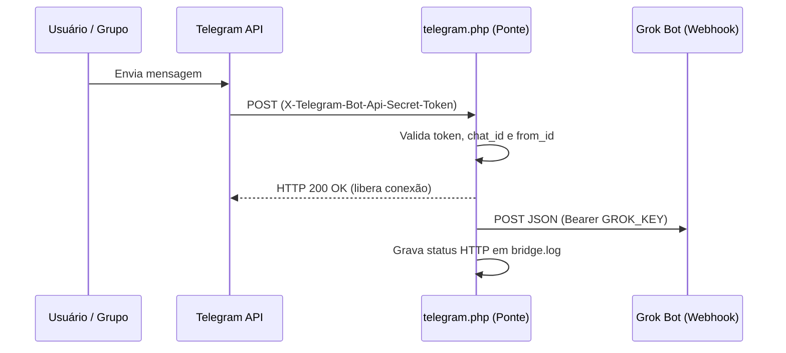

# Ponte Telegram → Grok Bot (Webhook)

Script leve em PHP que atua como ponte (*webhook bridge*) entre a **Bot API do Telegram** e uma rotina com gatilho **Webhook no Grok Bot**, acordando o agente instantaneamente a cada nova mensagem autorizada.

---

## Como funciona



1. **Autenticação da origem:** Verifica se a requisição é `POST` e se o cabeçalho `X-Telegram-Bot-Api-Secret-Token` corresponde ao `TG_SECRET` configurado (comparação em tempo constante via `hash_equals`).
2. **Filtragem estrita (Allowlist):** Descarta mensagens enviadas por bots, eventos sem texto/legenda e mensagens vindas de usuários (`$ALLOWED_USERS`) ou conversas (`$ALLOWED_CHATS`) não listados.
3. **Resposta imediata ao Telegram:** Retorna `200 OK` e encerra a requisição com o Telegram (`fastcgi_finish_request` / `flush`) antes de acionar o Grok Bot, evitando timeouts e reenvios duplicados.
4. **Repasse e diagnóstico privado:** Envia o `update` ao endpoint do Grok Bot via cURL e grava apenas metadados da entrega (`timestamp`, `update_id`, `chat_id` e código HTTP) em `bridge.log` — sem salvar o conteúdo das mensagens.

---

## Estrutura de arquivos

| Arquivo | Descrição |
| :--- | :--- |
| `telegram.php` | Script principal da ponte que recebe o webhook do Telegram e repassa ao Grok Bot. |
| `config.exemplo.php` | Modelo de configuração (sem dados sensíveis). Deve ser copiado para `config.php`. |
| `config.php` | *(Ignorado no Git)* Guarda os tokens secretos e os IDs de chats e usuários permitidos. |
| `.htaccess` | Regras para Apache que bloqueiam listagem de diretórios e acesso HTTP direto a `config.php`, `bridge.log` e arquivos internos. |

---

## Pré-requisitos

- Hospedagem web com **HTTPS** ativo (exigência da API de Webhooks do Telegram).
- **PHP 7.4+** ou **PHP 8.x** com as extensões `curl` e `json` habilitadas.
- Servidor Apache (para uso automático do `.htaccess`) ou Nginx (veja nota de segurança abaixo).
- Um bot criado no Telegram via [@BotFather](https://t.me/BotFather).
- Uma rotina configurada com gatilho **Webhook** no Grok Bot.

---

## Passo a passo de instalação

### 1. Obter os dados do Webhook no Grok Bot

Abra a rotina **Telegram (webhook)** no Grok Bot e, na seção **Webhook**, copie os campos:
- **POST to** (URL do webhook) → será usado em `GROK_URL`
- **key** (chave de autenticação) → será usado em `GROK_KEY`

Caso os campos não apareçam diretamente na interface, utilize os atalhos abaixo no navegador/aplicativo (ou solicite ao bot):
- [Abrir Webhook URL](grokbot://app/v1/sidebar?target=webhook-url&automation=telegram-webhook-responder-mensagens) (`GROK_URL`)
- [Abrir Webhook Key](grokbot://app/v1/sidebar?target=webhook-key&automation=telegram-webhook-responder-mensagens) (`GROK_KEY`)

### 2. Gerar a senha secreta do Telegram (`TG_SECRET`)

Crie uma senha aleatória com **32 caracteres ou mais**, contendo apenas letras, números, `_` e `-`:

```bash
openssl rand -base64 48 | tr '+/' '_-' | tr -d '=' | cut -c1-40
```

### 3. Configurar o `config.php`

1. Faça uma cópia de `config.exemplo.php` com o nome `config.php`:
   ```bash
   cp config.exemplo.php config.php
   ```
2. Preencha os valores em `config.php`:
   ```php
   define('TG_SECRET', 'SUA_SENHA_ALEATORIA_AQUI');
   define('GROK_URL', 'https://seu-endpoint-de-webhook');
   define('GROK_KEY', 'SUA_CHAVE_DO_WEBHOOK');

   // IDs numéricos dos chats autorizados (positivos para chat privado, negativos para grupos)
   $ALLOWED_CHATS = [123456789, -1009876543210];

   // IDs numéricos dos usuários autorizados
   $ALLOWED_USERS = [123456789];
   ```
3. Envie `telegram.php`, `config.php` e `.htaccess` para o diretório desejado no seu servidor HTTPS (ex.: `https://seu-dominio.com/bot/`).

### 4. Registrar o Webhook no Telegram

Abra o endereço abaixo no navegador (ou execute via `curl`), substituindo:
- `TOKEN_DO_BOT` pelo token fornecido pelo `@BotFather`
- `https://seu-dominio.com/bot/telegram.php` pela URL pública onde o script foi hospedado
- `SUA_SENHA_TG_SECRET` pelo valor exato definido em `TG_SECRET` no `config.php`

```text
https://api.telegram.org/botTOKEN_DO_BOT/setWebhook?url=https://seu-dominio.com/bot/telegram.php&secret_token=SUA_SENHA_TG_SECRET
```

A resposta esperada do Telegram é:
```json
{"ok":true,"result":true,"description":"Webhook was set"}
```

---

## Diagnóstico e Segurança

- **Log de entregas (`bridge.log`):** Se alguma mensagem não acionar o bot, verifique o arquivo `bridge.log` gerado no mesmo diretório do servidor. Cada linha exibe o horário, o `update_id`, o `chat_id` e o código HTTP retornado pelo Grok Bot (`grok_http=200` ou `202` indica sucesso):
  ```text
  2026-10-31T22:55:00-03:00 update=123456789 chat=123456789 grok_http=200
  ```
- **Privacidade:** Nenhum texto de mensagem ou token é gravado no arquivo de log.
- **Usuários de Nginx:** O arquivo `.htaccess` funciona apenas no Apache. Se utilizar Nginx, adicione ao bloco `server` a regra abaixo para bloquear o acesso direto ao `config.php` e aos logs:
  ```nginx
  location ~ /(config(\.exemplo)?\.php|.*\.log|README\.md|\.git) {
      deny all;
      return 404;
  }
  ```
